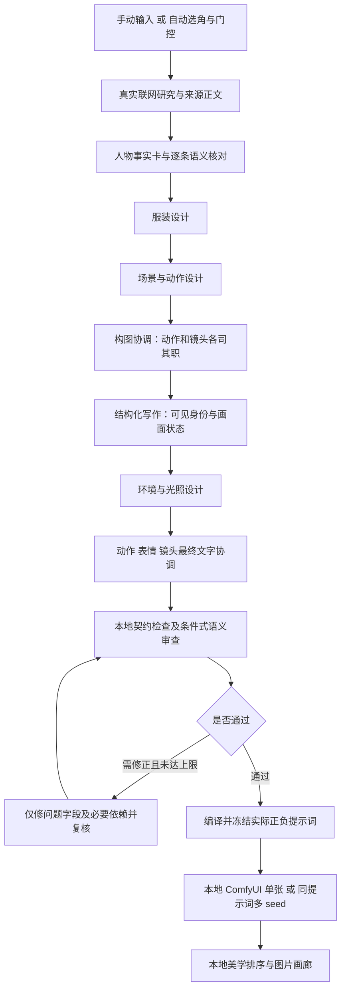

# Anima Pipeline：用 LLM 为不同人物、不同场景生成可执行的绘画提示词

这是一个本地二次元出图工具：先用 **DeepSeek V4 Flash 1017** 联网研究人物，再把人物事实、换装设计、动作、镜头、背景和光照整理成适合 **Anima-2.9B-preview-v1** 的提示词，交给本地 ComfyUI 生成图片。可手动选择人物和参数，也可让程序自动选角、选主题，并对同一提示词生成的候选进行本地美学排序。

项目的重点是让同一套流程用于**多个作品的人物和多种主题场景**，尽量减少事实混入、换装污染、动作与镜头争夺构图、光照矛盾等问题。默认画面是 `1girl, solo`；这里的“多人物”指人物池的覆盖范围，不能理解为已经解决多人同框、人物间属性绑定或复杂互动。

公开版只提供本地出图。自动发布、社交平台登录、排期、启动任务、跨次人物轮换池、长期黑名单、人物资料磁盘缓存和历史迁移处理均不包含在本仓库中。本次任务的提示词、证据、seed、候选、评分和实际提交工作流保存在当前输出目录中，方便复现和微调；不作为下一次运行的历史输入。

## 模型适配范围

| 用途 | 当前适配基线 | 实际配置与边界 |
|---|---|---|
| 提示词生成与语义核对 | **DeepSeek V4 Flash 1017** | 默认 API 请求名 `deepseek-flash`，配置项 `DEEPSEEK_MODEL`。该名称是服务方别名，代码不能保证服务方永远将它固定到 1017；部署时请自行确认服务实际版本。 |
| 绘图 | **Anima-2.9B-preview-v1** | `config.py` 中配置原生 bf16 和 int8 两种权重。文件名里的 `Anima` 是本仓库采用的模型名称；并非 Animagine XL。 |
| 候选美学排序 | **`kawaimasa/kawai-aesthetic-scorer-convnextv2`** | Transformers 图像分类器，本地加载；不向该模型服务上传图片。 |

**使用本项目时请注意：提示词设计、混合标签写法、事实契约、修正指令、thinking 工具回填及 token 限额，均围绕 DeepSeek V4 Flash 1017 + Anima-2.9B 这两个模型优化。换用其他对话模型或绘图模型，可能需要重新设计 API 适配、提示词编译、预算和采样参数，不应视为直接兼容。** 美学模型也针对其训练偏好排序，不保证符合每个人的审美。

Anima 适合将熟悉的角色／作品标签与较详细的英文自然语言描述混合使用。标签提供人物、主题、风格锚点，关系句描述服装结构、身体接触、空间和光照。本项目不设“通用最佳字数”，也不把更长文本、更多质量词或更深阴影视为画质提升。复杂器械接触、左右手精确分工、罕见视角、脸部还原和细小饰品仍受绘图模型能力及 seed 影响。

当前人物选材上限为 **2026-07（含 7 月）**，按角色本人的首次公开登场日期处理；它不是“这个月以前所有人物模型都认识”的保证，也不禁止为已符合条件的人物查询较新的外观细节。来源版本、归属和明确排除的设计仍须一致。相关逻辑见 [`anima_source_policy.py`](anima_source_policy.py) 和 [`character_gate.py`](character_gate.py)。

## 两条出图工作流

两条线路使用同一组 Anima 权重和同一条提示词生成链，区别在本地 ComfyUI 图与采样方法：

| 线路 | 文件与节点 | 默认采样设置 |
|---|---|---|
| `api` | [`workflow_api.json`](workflow_api.json)，`KSampler` + `ModelSamplingAuraFlow` | 50 步，4 组组合可选或随机，见下表。 |
| `anima_flow` | [`workflow_anima_flow.json`](workflow_anima_flow.json)，`AnimaFlowCorrectiveSampler` | 50 步，`cfg_mode=const`、`flow_solver=flow_euler`、`flow_schedule=flow_diffusers_linear_shift`、`flow_shift=3.0`。 |

`api` 的 4 组采样器组合为：

| 采样器 | 调度器 | 步数 |
|---|---|---:|
| `euler` | `sgm_uniform` | 50 |
| `res_multistep` | `linear_quadratic` | 50 |
| `er_sde` | `beta57` | 50 |
| `uni_pc` | `ddim_uniform` | 50 |

CFG 会被本次画风策略统一设置：启用画风标签时为 **3.7**，不启用时从 **3.5～5.0** 随机取值，两条工作流都如此。不要仅看工作流模板里原先存下的 CFG／Flow 参数；运行时会用 `config.py` 的设置覆盖，并另存实际提交的图。

默认输出尺寸为 **1024 × 1536**。原生 bf16 与 int8 可以手动选择或随机选择，速度、显存和结果差异需在自己的硬件上确认。节点、采样器名称及调度器必须在你的 ComfyUI `/object_info` 中可用；特别是 Flow 自定义节点和 `beta57`，不能只凭 JSON 文件存在就认定安装完成。

## 安装和本地配置

建议 Python 3.10 及以上，先安装并配置能够执行上述 Anima 工作流的 ComfyUI。模型权重、自定义节点、CUDA 和显存需求属于绘图环境，本仓库不捆绑权重或替你安装 ComfyUI。

```powershell
python -m venv .venv
.\.venv\Scripts\Activate.ps1
python -m pip install -r requirements.txt
```

在 ComfyUI 中放好这些文件，实际名称不同则同步修改配置／工作流：

| 文件 | 常规目录 |
|---|---|
| `Anima-2.9B-preview-v1.safetensors` | `ComfyUI/models/diffusion_models/` |
| `Anima-2.9B-preview-v1_int8_convrot.safetensors` | `ComfyUI/models/diffusion_models/` |
| `qwen_3_06b_base.safetensors` | `ComfyUI/models/text_encoders/` |
| `Anime_2.9B_vae(qwen_vae1).safetensors` | `ComfyUI/models/vae/` |

随机权重模式需要两种权重都可用；只有一种时，在自选入口中明确选择它，或调整 `ANIMA_MODEL_CHOICES`。`api` 模板的文本编码器类型是 `lumina2`，`anima_flow` 模板是 `stable_diffusion`，请按所用 Anima／ComfyUI 节点实现确认；不要未经验证套用到其他模型。

当前 PowerShell 会话配置示例：

```powershell
$env:DEEPSEEK_API_KEY = '填写你自己的密钥'
$env:DEEPSEEK_BASE_URL = 'https://api.deepseek.com'
$env:DEEPSEEK_MODEL = 'deepseek-flash'
$env:COMFY_URL = 'http://127.0.0.1:8188'
```

也可以将 `.env.example` 复制为 `.env`，只填写 `DEEPSEEK_API_KEY`。**内置 `.env` 读取器只加载这个密钥；其他选项使用环境变量或修改 `config.py`。** `.env` 已在 `.gitignore` 排除，不要把真实值写进源码或截图。

默认由你启动 ComfyUI，程序只检查服务是否就绪。Windows 上若需要程序启动本地 ComfyUI，额外设置 `COMFY_DIR`、`COMFY_PYTHON`、`COMFY_AUTOSTART=1`；路径使用自己的安装位置。入口菜单的“9”也能修改本进程使用的路径。该功能只管理本地绘图服务，不创建操作系统计划任务；配置不写入长期用户设置。

### 启用美学排序

基础依赖能运行菜单和出图调用；有效的美学排序还需要 PyTorch、Transformers 和评分模型。先按自己的 CPU／CUDA 环境安装合适的 PyTorch，再安装：

```powershell
python -m pip install -r requirements-scoring.txt
```

评分模块运行时设置 Hugging Face／Transformers 离线模式，需在**尚未导入本项目模块的新进程**中提前下载并验证模型：

```powershell
python -c "from transformers import pipeline; pipeline('image-classification', model='kawaimasa/kawai-aesthetic-scorer-convnextv2')"
```

若系统已设置 `HF_HUB_OFFLINE` 或 `TRANSFORMERS_OFFLINE`，先在下载用终端解除它们。评分器加载失败时会显示失败并返回 0 分；全体同分时随机选取，所以“程序有选中图”并不代表评分器正常。先确认实际评分可用，再使用五选一。

## 如何出图

**自选入口：**

```powershell
python custom_entry.py --list
python custom_entry.py --dry-run
python custom_entry.py
```

菜单顺序是：工作流 → 权重 → KSampler 组合（仅 `api`）→ 画风组合 → 人物和作品中英文标签、外观版本 → 18 主题之一 → 背景来源 → 1 张或五选一 → 起始 seed。支持不加画风标签、指定组合或随机；起始 seed 留空则随机，五选一指定 seed 时连续 `+1`。当前 seed 范围是 `0..2147483647`，连续候选也必须在范围内。完整用法见 [`docs/CUSTOM_ENTRY.md`](docs/CUSTOM_ENTRY.md)。

**自动本地出图入口：**

```powershell
python pipeline_character.py --dry-run
python pipeline_character.py --workflow api --count 1 --theme 和服
python pipeline_character.py --workflow anima_flow --count 5 --route deepseek
```

每次命令只运行一次本地任务。自动入口先选人物／主题、规范标签并通过人物范围门控，再进入与自选入口相同的“人物预检 → 设计 → 写作 → 审查 → 出图 → 选图”流程。它可以在人物证据确实不可用且达到修正上限时更换人物；自选入口保持你的选人，失败则明确结束。两者都不会向社交平台发送内容。

**“两条工作流”与“背景来源”不同。** 背景来源 `mixed` 默认约 1/3 从主题场景清单选一个、2/3 由 DeepSeek 设计地点；`fixed` 固定使用场景清单，但并非锁定同一张背景图；`deepseek` 由模型设计。室内外、时段、天气、季节和主题约束会一并协调。“背景”主题仍保留角色，表示偏向保留原装、设计环境，不是纯风景模式。

## 提示词生成链：先拆职责，再协调画面



1. **研究和写作分开。** `prompt_refinement.py` 搜索人物资料并读取正文，`anima_prompt_pipeline.Session.fact_card` 将可追溯引文变成结构化事实。网页只作不可信资料，不接收其中的操作指令；未查实的细节不伪装成官方设定。
2. **先核对事实，再设计。** 发型、瞳色、标志饰品、体型和原装分别存放，每条事实带来源、逐字引文、版本和可见部位。审查需判断引文是否支持该人物的该属性，不能只满足“这句话出现在网页里”。细分术语和数量／附着位置也需保真。
3. **人物身份与换装分离。** 换装写作输入剔除原装披肩、手套等服装事实，保留有依据的身份特征；眼睛颜色必须写成 `gray-purple eyes` 等完整属性短语。衣服的配色、剪裁、材料、饰品相互配合，并结合人物资料，而非所有人物套一套服装。
4. **让画面设计拥有明确职责。** 服装层确定设计，场景层确定一个可执行动作，构图层统一视角、裁切、人物位置和画面内背景。`pose` 说明身体／接触关系，`composition` 说明镜头；隐藏的脚、衣服背面等不能继续在其他字段里被要求展示。
5. **背景和光照按同一空间设计。** 环境层只改场景、光照及获准的可见性依赖，保留人物、服装和动作意图。以可辨认的地点、前中远景、材质、主光方向和反射关系提高完整性；室外泳装需读得出沙滩／海浪／海域，和服禁止摊位背景，运动优先避免复杂器械操作。
6. **最后协调及有限修正。** 最终视觉协调只处理动作、表情、镜头的文字一致性，不把服装或环境推倒重写。审查发现问题后，只能修改被指出的字段及直接相关依赖，并再次验证；不靠不断生成新稿来掩盖失败。
7. **编译和渲染有边界。** 编译器拥有身份事实和体型字段，写作层拥有创意画面。最终提示词和可见性契约经核对后冻结；渲染端只按规则注入本次画风组合、传入 seed／采样设置，并保存实际提交值，避免后处理偷偷改变已批准正文。

详细调用顺序、输入／输出、修正边界、预算以及微调地图见 [`docs/ARCHITECTURE.md`](docs/ARCHITECTURE.md)。

## 修正上限、费用与失败

人物事实修正最多 **2 轮**，每轮“修改 → 再核对”。自动入口因证据不足或事实修正耗尽，最多更换 **2 次人物**，即最多处理 3 个人物；选角门控最多 9 次候选尝试。网络、密钥或无效审查契约问题不当成人物问题来盲目换人。自选入口不偷偷更换人物。

默认开启分阶段设计时，画面文本修正上限是 **3 轮**；仍无法通过时停止，不提交 ComfyUI。常用设计／稳定写作／画面修正输出限额为 **32,000 token**，事实及语义审查为 **48,000 token**。仅当 API 明确报告输出预算耗尽，允许升到 **64,000 token** 恢复：事实预检范围一次，后续全部提示词阶段共享一次，不逐环节重置。上限包含模型推理与输出预算，不代表每次实际消耗这些 token。

各阶段调用还受会话请求数上限约束，详见运行数据中的 `request_limit`、`role_budgets`、`requests` 和 `budget_recovery_scope`。固定价格不写死；实际开销取决于模型版本、来源可用性、工具费和修订次数。`pipeline_character.usage_summary()`、`web_search.web_usage_summary()` 可用于本进程核算，不能把输出上限直接当账单。

## 美学评分和五选一

五选一模式先生成一份通过检查的主提示词，再保持其正文、权重、采样器和画风组合一致，换 5 个 seed；不是调用 5 次完整 LLM 链。现有写作契约可能同时包含姿势备选字段，默认 `ANIMA_SAME_PROMPT_SEEDS=True` 时仍只渲染主稿。

评分器 `kawaimasa/kawai-aesthetic-scorer-convnextv2` 返回等级概率，本项目按 **SS=5、S=4、A=3、B=2、C=1** 计算加权期望分。取最高分，有效分数相同时随机选一张；所有候选保留。评分比较针对当前批次，不是画质百分制，也没有通过分数保证角色像、四肢正确或背景合理。

默认没有启用额外的眼部 VLM 检查；顶部裁切像素惩罚函数目前返回 0。`identity_judge` 等兼容函数的存在不代表默认执行了人物身份审图。文字一致性与美学排序都需要配合查看实际图片。

## 输出与微调入口

```text
output/custom 或 output/automatic/
  日期/本次任务/
    查看图片.html
    图片/
      全部候选图/stable/   # 文件名含 seed
      程序选中图/
    数据/
      提示词会话/          # 本任务来源、阶段输入输出、事实审查与修订
      候选记录/            # 实际正负提示词与 seed
      实际工作流/          # 提交到 ComfyUI 的图
      *_aesthetic_selection_*.json  # 本地评分模型、候选分数与选中路径
    last_entry.json
```

输出目录实际还包含微秒和随机短标识，避免同一秒任务重名。图片和数据分开放置，打开 `查看图片.html` 可比较候选并进入其提示词记录。ComfyUI 自己的输出目录也可能保留一份图片，这是本地绘图服务的行为。

| 想调整的内容 | 优先阅读／修改 |
|---|---|
| 模型、采样组合、画风池、CFG、预算、季节和场景池 | [`config.py`](config.py) |
| 自选菜单、一次运行的参数覆盖和恢复 | [`custom_entry.py`](custom_entry.py) |
| 自动选角、联网工具循环、thinking 回填、会话串接 | [`pipeline_character.py`](pipeline_character.py) |
| 来源查询、正文与可追溯事实 | [`prompt_refinement.py`](prompt_refinement.py)、[`web_search.py`](web_search.py) |
| 人物预检、事实修正、有限换人 | [`anima_character_card.py`](anima_character_card.py) |
| 版本／来源优先级、轻微外观分歧 | [`anima_source_policy.py`](anima_source_policy.py)、[`anima_character_variants.py`](anima_character_variants.py) |
| 分阶段设计、条件审查、局部修正、编译、冻结 | [`anima_prompt_pipeline.py`](anima_prompt_pipeline.py) |
| 术语保真、审查归因、可见性和字段契约 | [`anima_fact_semantics.py`](anima_fact_semantics.py)、[`anima_prompt_contracts.py`](anima_prompt_contracts.py) |
| 动作／表情／镜头最终文字协调 | [`anima_visual_focus.py`](anima_visual_focus.py) |
| 实际采样图、候选生成、评分与本地选图 | [`comfy_runner.py`](comfy_runner.py) |
| 图片画廊 | [`anima_prompt_storage.py`](anima_prompt_storage.py) |

画风菜单统一使用“画风标签／画风组合”。内部保留 `ARTIST_*`、`artist_roll` 等历史配置和函数名以保持调用兼容，原始 `@...` 模型标签与负面标签 `artist name` 也按模型词法保留；改称呼不等于重写这些 token。

微调时尽量固定人物、主题、权重、采样器和 seed，一次只改一个设计职责；同时比较原本满意和不满意的图片。优先修事实依据、字段冲突和画面组织，避免仅凭最高美学分启用新策略。仓库不附带内部测试脚本、私人样图、运行数据或账号资料。

## 数据流与安全

LLM 与联网是外部 API：人物／作品标签、研究文本、阶段输入会发给配置的模型服务，搜索词与目标 URL 会发给搜索／抓页服务。绘图和美学排序默认在本地执行；自动选角在部分主题下还沿用可选的参考图体型核对分支，该分支会把参考图发给配置的模型 API，且要求服务支持图像输入；它不构成可靠的人体或身份检测器。详见 [`SECURITY.md`](SECURITY.md)。

只公开经过整理的源代码和静态标签数据；不包含个人机器路径、密钥、登录态、发布队列或运行历史。运行后新增的图片、网页引文、提示词和错误记录仍可能包含个人输入或本地绝对路径，已默认排除版本控制，分享前应自行检查。模型权重、标签数据与原始画风 token 的上游许可和使用条件请分别遵守。
