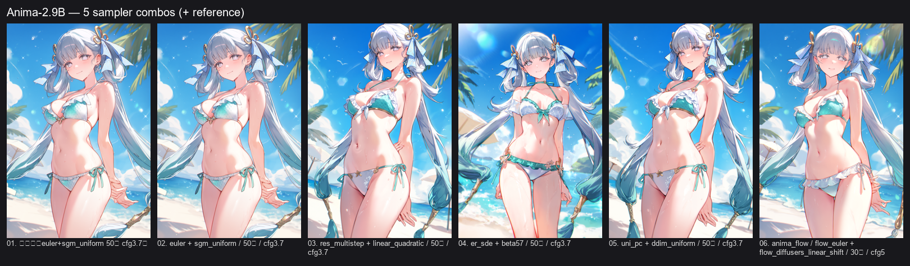
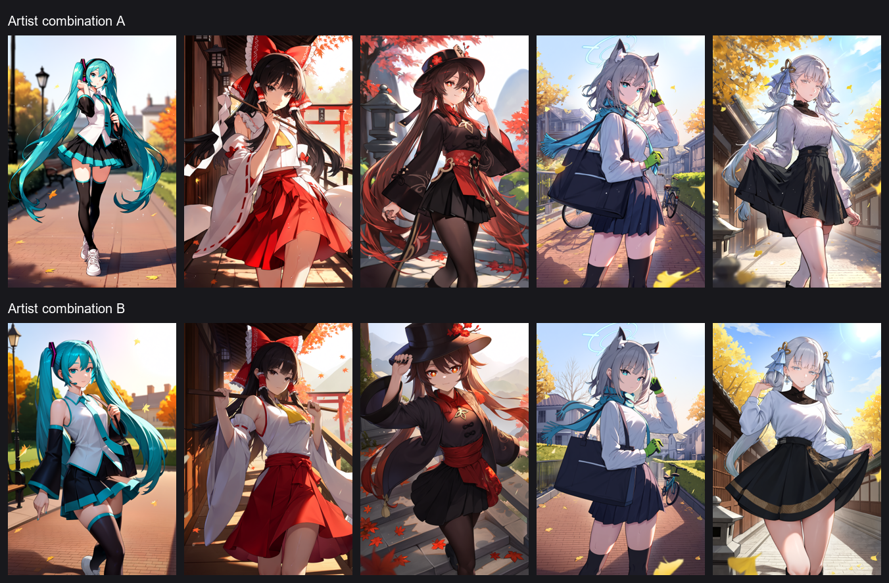

# anima-pipeline

一个面向 **Anima-2.9B** 的二次元角色出图流水线：自动选角、核验角色是否在模型知识范围内、生成结构化提示词、调用本地 ComfyUI 出图，并按候选质量选优。

公开版只保留 **Anima-2.9B 的 `api` / `anima_flow` 两条出图线路**，不包含人物 LoRA、旧模型线路、模型权重、生成图库或任何社交平台上传功能。

> 这是一个个人向研究项目，不是开箱即用的商业产品。模型权重、ComfyUI 和第三方 API 需要自行准备。

---

## 快速开始

三条最常用的命令：

```powershell
python smoke_test.py                 # 只验证本地出图，不需要 DeepSeek key
python pipeline_character.py         # 完整自动链路，需要 DeepSeek key
python custom_entry.py               # 手工指定角色，需要 DeepSeek key + ComfyUI
```

手工入口还有两种不消耗 API 的辅助用法：

```powershell
python custom_entry.py --list        # 只列出模型/采样器/画师组合
python custom_entry.py --dry-run     # 只走菜单，不调用 API、不出图
```

手工入口的完整交互说明（输入顺序、字段含义、示例、输出位置）：

**[docs/CUSTOM_ENTRY.md](docs/CUSTOM_ENTRY.md)**

---

## 样图

### 采样器组合对比



同一角色、同一模型下比较不同 KSampler 组合。实际运行时采样器组合由 `config.KSAMPLER_COMBOS` 随机抽取。

### 画师组合 A / B 匿名对比



两套画师组合、同一组 5 个角色、同一模型与采样设置。为避免把个人审美偏好误读为对具体画师的评价，公开样图不标注画师姓名，也不提供 A/B 与姓名的对应关系。

样图来自本地实验，仅用于展示风格差异；不保证换机器、换 seed 后复现同一结果。

---

## 功能范围

- **选角**：DeepSeek 通过本地 `web_search` 函数工具联网选角，输出角色、作品、主题、视觉特征。
- **能力门控**：用 Danbooru 标签投稿数、作品/角色出道年份、模型知识截止日期，判断模型是否可能认识该角色。
- **提示词**：把角色、作品、服装、姿势、表情、场景、光照整理成 Anima 训练格式的标签串。
- **画师组合**：按作品/通用池注入画师串，支持权重截断。
- **出图**：调用本地 ComfyUI，`api` 与 `anima_flow` 两条线路随机选择。
- **候选选优**：一次生成多张，按本地美学评分选优；可选身份一致性复核。
- **安全门控**：暴露类主题下，对角色体型做 VLM 复核（`body_judge.py`）。
- **手工入口**：`custom_entry.py` 可指定角色、采样器和画师组合。

不包含：

- 人物 LoRA 的搜索、下载、挂载或质量 A/B
- 社交平台的内容分发或定时推送
- 模型权重、LoRA 权重、生成图库
- 任何登录凭据、会话材料或个人身份信息

---

## 目录结构

```text
anima-pipeline/
├─ pipeline_character.py     # 主链：选角 → 门控 → 提示词 → 出图 → 选优
├─ custom_entry.py           # 手工指定角色/采样器/画师组合
├─ comfy_runner.py           # ComfyUI 构图、采样、候选评分
├─ character_gate.py         # 角色 × 模型能力门控
├─ body_judge.py             # 暴露主题下的体型 VLM 复核
├─ booru_client.py           # Danbooru/Safebooru 标签与参考图查询
├─ web_search.py             # 选角阶段的本地联网搜索工具
├─ prompt_style.py           # 提示词风格补充
├─ pool_manager.py           # 角色池与 JSON 解析
├─ ensure_comfyui.py         # ComfyUI 健康检查/可选自动拉起
├─ smoke_test.py             # 不依赖 DeepSeek 的最小出图验证
├─ artist_matrix_test.py     # 仅保留 _slug / _replace_artist 两个工具函数
├─ workflow_api.json         # Anima KSampler 线路
├─ workflow_anima_flow.json  # AnimaFlow 线路
├─ workflow_refine.json      # 通用 img2img 精修图
├─ data/
│  ├─ artist_combos.json
│  ├─ character_debut_years.json
│  └─ danbooru_tags.csv
├─ docs/
│  ├─ CUSTOM_ENTRY.md      # 手工入口完整说明
│  └─ samples/
└─ requirements.txt
```

---

## 环境要求

- Python 3.10+
- 本地 ComfyUI（建议较新版本）
- 以下模型文件（文件名必须与 workflow/JSON 中一致，或在 `config.py` 中改常量）：

```text
ComfyUI/models/unet/Anima-2.9B-preview-v1.safetensors
ComfyUI/models/unet/Anima-2.9B-preview-v1_int8_convrot.safetensors   # 可选，int8 快档
ComfyUI/models/clip/qwen_3_06b_base.safetensors
ComfyUI/models/vae/Anime_2.9B_vae(qwen_vae1).safetensors
```

- `api` 线路只依赖 ComfyUI 原生节点。
- `anima_flow` 线路依赖提供 `AnimaFlowCorrectiveSampler` 节点的 ComfyUI 扩展；未安装时请只使用 `api` 线路，或把 `WORKFLOW_POOL` 改为 `["api"]`。
- 本地美学评分是可选项：`comfy_runner.py` 会尝试加载 `kawaimasa/kawai-aesthetic-scorer-convnextv2`。未安装 `transformers` / 本地没有缓存时，评分失败会退化为 0 分，不影响出图。
- 公开版主要在 Windows 上验证。`ensure_comfyui.py` 的自动拉起/停止使用 Windows 进程命令；Linux/macOS 建议手动启动 ComfyUI，只使用健康检查。

---

## 安装

如果已经拿到项目目录：

```powershell
cd anima-pipeline
python -m venv .venv
.venv\Scripts\activate
pip install -r requirements.txt
```

如果从远端克隆，把 `<repo-url>` 换成实际地址：

```powershell
git clone <repo-url>
cd anima-pipeline
```

可选（本地美学评分）：

```powershell
pip install transformers torch
```

注意：`comfy_runner.py` 在导入时设置了 `HF_HUB_OFFLINE=1` / `TRANSFORMERS_OFFLINE=1`，所以评分模型需要在离线前已经缓存到本机。没有缓存时评分会失败并退化为 0 分，不影响出图。

---

## 配置

所有敏感配置只从环境变量读取，不写入仓库。

```powershell
$env:DEEPSEEK_API_KEY = "你的 DeepSeek API key"
$env:COMFY_URL = "http://127.0.0.1:8188"          # 可选
$env:COMFY_DIR = "C:\ComfyUI"                     # 可选：用于自动拉起
$env:COMFY_PYTHON = "C:\ComfyUI\venv\Scripts\python.exe"
```

`config.py` 中 `COMFY_DIR` / `COMFY_PYTHON` 默认为空；只填环境变量即可。未配置这两个变量时不会尝试自动拉起 ComfyUI，需先手动启动。

检查 ComfyUI：

```powershell
python ensure_comfyui.py --status
```

---

## 启动与使用方案

公开版有三种用法，按“先验证、再完整运行”的顺序使用。

### 1. 最小验证：只测本地出图（无需 DeepSeek）

```powershell
python smoke_test.py
```

它会用 `workflow_api.json` 生成一张 8 步测试图，验证 ComfyUI、UNet、CLIP、VAE 和 workflow 是否正常。成功输出类似：

```text
[smoke] OK: .../output/smoke/smoke.png (1024x1536, ... bytes)
```

如果这一步失败，先不要运行主链，按报错检查 ComfyUI 是否启动、模型文件名是否与 `config.py` 一致。

### 2. 完整自动链路（需要 DeepSeek API key）

```powershell
python pipeline_character.py
```

流程：DeepSeek 选角 → 门控 → 提示词 → ComfyUI 出图 → 选优。

### 3. 手工指定角色/采样器/画师组合

> 完整逐步说明已单独整理：[docs/CUSTOM_ENTRY.md](docs/CUSTOM_ENTRY.md)

手工入口**不经过自动选角和角色门控**：你直接给角色标签，适合已经知道要画谁、只想换采样器或画师组合的情况。模型不认识该角色时，仍可能出现通用脸。

建议按“看选项 → 演练 → 实际出图”三步使用。

#### 3.1 先看有哪些选项（不需要 DeepSeek key）

```powershell
python custom_entry.py --list
```

只打印可选模型、4 组采样器和 27 组画师组合，然后退出。不调用 DeepSeek，不启动 ComfyUI，不出图。

#### 3.2 演练一遍输入（不需要 DeepSeek key）

```powershell
python custom_entry.py --dry-run
```

会完整走一遍菜单，最后打印本次模型、角色、主题、景别和采样器，但**不调用 DeepSeek、不启动 ComfyUI、不写图片**。

#### 3.3 实际出图（需要 DeepSeek key + ComfyUI）

```powershell
python custom_entry.py
```

交互顺序固定如下：

```text
选择模型编号：1
  1 = Anima-2.9B api
  2 = Anima-2.9B anima-flow
  9 = 修改 ComfyUI 路径（保存到 user_settings.json）
  q = 退出

选择采样器组合编号（默认 1）：1
  1 = euler + sgm_uniform
  2 = res_multistep + linear_quadratic
  3 = er_sde + beta57
  4 = uni_pc + ddim_uniform

选择画师组合编号（0=不加画师，默认 0）：0
  0 = 不注入画师串
  1~27 = 对应组合

人物中文名：初音未来
作品中文名：Vocaloid
人物英文标签（如 furina_(genshin_impact)）：hatsune_miku
作品英文标签（如 genshin_impact）：vocaloid
主题（默认 四季常装）：四季常装
景别（默认 cowboy shot）：cowboy shot
seed（默认 20261022）：20261024
```

英文标签建议直接使用 Danbooru 标签；带歧义的角色用 `角色_(作品)` 写法。`景别` 可填：

- `cowboy shot`：七分身/膝上
- `full body`：全身

成功后输出一张图：

```text
output/_custom_entry/<YYYY-MM-DD>/<角色>_<主题>.png
output/_custom_entry/<YYYY-MM-DD>/last_entry.json
```

全部输出位置：

```text
output/character/<YYYY-MM-DD>/     # 主链
output/_custom_entry/<YYYY-MM-DD>/ # 手工入口
output/smoke/smoke.png             # 最小验证
```

---

## 出图流程

```text
DeepSeek 选角（联网搜索）
        ↓
danbooru 标签 / 出道年份 / 模型截止日期门控
        ↓
暴露主题 → 体型 VLM 复核（body_judge）
        ↓
生成结构化提示词（角色、服装、姿势、表情、场景、光照）
        ↓
随机线路 api / anima_flow → 随机采样器组合 → 画师串 50% 注入
        ↓
ComfyUI 生成 N 张候选
        ↓
本地美学评分 + 可选身份复核
        ↓
输出最终选中图
```

门控失败会重选角色或换线路；不会为了凑数跳过门控。

---

## 提示词结构

Anima 线路使用 Danbooru 风格的标签串，核心结构如下：

```text
year 2025, masterpiece, best quality, score_7, safe,
1girl, solo, <character>, <series>,
<artist combo>, <outfit>, <pose>, <expression>,
<scene>, <lighting>, <detail tags>
```

说明：

- `year 2025, masterpiece, best quality, score_7, safe` 是 `ANIMA_PREFIX`，固定作为质量/年份前缀。
- 角色与作品标签放在主体位置；画师串插在作品标签之后，避免破坏角色名括号。
- 负面提示词包含低质量、解剖错误、文字/水印等通用项，并按主题追加场景/构图负面。
- 画师串不是每条都加：`artist_roll()` 以约 50% 概率触发；触发时 CFG 固定为 3.7，未触发时使用 3.5–5.0 的随机区间。
- `api` 线路会从 `KSAMPLER_COMBOS` 随机抽一套采样器/调度器/步数/CFG；`anima_flow` 使用固定的 flow 采样参数。

---

## 画师组合依据

画师组合不是随机拼人名，而是按以下思路整理：

1. 以 Safebooru 上各作品约 500 张样本为统计对象，统计画面中出现的画师标签频次。
2. 取高频、风格相容的组合，控制每串人数（通常 1 主 + 1 辅，最多 3 人）。
3. 主画师保持权重 1.0；辅画师原始权重 0.7–0.8，运行时统一截断到 `SECONDARY_ARTIST_WEIGHT_MAX`（默认 0.65）。
4. 作品分类找不到时使用通用池；公开版默认启用全局池。
5. 组合列表在 `data/artist_combos.json`，运行时会优先读取该文件；文件缺失时使用 `config.py` 中的同值兜底。

公开样图只标 **Artist combination A / B**，不标具体画师名。这样可以展示“组合会改变画面”，同时避免把样图质量归因于某位画师。

---

## DeepSeek 参与环节

本项目使用 DeepSeek 的对话/多模态能力，具体参与三个环节：

### 1. 选角

`pipeline_character.py` 调用 DeepSeek，要求它联网搜索并返回角色、作品、主题、视觉特征。联网不是模型内置能力，而是通过本地 `web_search.py` 的 function tool 执行，再把搜索结果回填给模型。

发送内容：提示词、已用角色列表、模型知识截止日期、搜索关键词/结果摘要。

### 2. 提示词生成

DeepSeek 把角色设定整理成结构化 JSON（角色标签、作品标签、服装、姿势、表情、场景、光照、瞳色等），再由本地代码组装成 Danbooru 标签串。

发送内容：角色名、作品名、主题、模型信息、格式要求。

### 3. 体型复核（仅暴露类主题）

`body_judge.py` 在主题属于泳装/暴露类时，从公开图站取最多 3 张该角色参考图，发给 DeepSeek 多模态接口判断是否属于儿童体型，并按多数票决定是否拒绝该角色。

发送内容：角色英文标签、参考图（压缩后的 PNG）。不会发送本地路径、环境变量或密钥。

### 数据与费用

- API key 只从 `DEEPSEEK_API_KEY` 读取。
- 调用会产生费用；`body_judge` 有本地 JSON 缓存，同一角色只判一次。
- 如果不想使用外部 API，需要自行替换选角/提示词/体型复核模块。

---

## 数据来源

### `data/danbooru_tags.csv`

- 内容：`tag, category, post_count, aliases`
- 用途：本地判断角色标签、作品标签、投稿热度；联网失败时的兜底。
- 来源：Danbooru 公开标签数据整理，快照时间约 2026-10。
- 说明：`category=4` 为角色，`category=3` 为作品/版权；计数会随时间变化，文件是静态快照。
- 公开版对明显与角色门控无关的少量通用标签做了过滤，不影响角色/作品门控逻辑。

### `data/artist_combos.json`

- 内容：按作品分组的画师组合 + 通用池。
- 用途：运行时注入画师串。
- 来源：Safebooru 作品样本的画师标签频次统计 + 人工筛选；不是对所有画师的客观排名。

### `data/character_debut_years.json`

- 内容：角色英文标签 → 出道年/日期、来源标记。
- 用途：角色级日期门控与画师策略分档。
- 来源：人工预设 + DeepSeek 联网确认 + 百科页面核对；属于近似数据，可能有个别误差。

### 联网来源

选角与日期核验使用公开搜索引擎（Bing RSS、360 等）和百科/WIKI 域名摘要；代码只采信限定域名的日期证据，查不到时会舍弃角色，而不是猜测。

---

## 安全与隐私

- 仓库不包含 API key、登录凭据、会话材料、个人身份信息。
- `COMFY_DIR` / `COMFY_PYTHON` 默认为空，路径只从环境变量读取。
- 仓库不包含模型权重、LoRA、生成图库或本地缓存。
- 公开样图已去除原始标题、画师名和文件元数据。
- 外部 API 调用会把角色文本或参考图发送到服务商；请自行评估隐私与合规要求。
- 详见 [SECURITY.md](SECURITY.md)。

---

## 已知限制

- 门控依赖 Danbooru 覆盖度；小众角色、非 Danbooru 作品可能被拒绝。
- Anima-2.9B 的知识截止按 2025-09 处理，之后出道的角色会被拦截。
- 画师组合基于有限样本，不代表普遍审美结论；换 seed/机器结果会变。
- `anima_flow` 需要额外 ComfyUI 节点；没有该节点时请只用 `api`。
- 本地美学评分模型未随仓库提供；缺失时选优退化为随机/同分选择。
- 公开版不包含人物 LoRA，因此不会通过 LoRA 提升角色还原度。

---

## 常见问题

**Q：启动时报 `DEEPSEEK_API_KEY` 相关错误？**  
A：先设置环境变量。模块导入不会因空 key 崩溃，但实际调用会鉴权失败。

**Q：`python ensure_comfyui.py --status` 显示未运行？**  
A：先手动启动 ComfyUI；或设置 `COMFY_DIR` / `COMFY_PYTHON` 让脚本尝试拉起。

**Q：`anima_flow` 报未知节点 `AnimaFlowCorrectiveSampler`？**  
A：安装对应 ComfyUI 扩展，或把 `config.WORKFLOW_POOL` 改为 `["api"]`。

**Q：角色一直被门控拒绝？**  
A：这是预期行为：门控宁可换人，也不让模型画一个它不认识的通用脸。可在 `config.py` 调整投稿数阈值，但这会降低还原度保障。

**Q：为什么没有 LoRA？**  
A：公开版只保留 Anima 的纯提示词线路。LoRA 的下载、家族校验、挂载和质量 A/B 已整体移除。

---

## 说明

- 本项目仅用于个人研究与技术交流。
- 模型、画师标签、角色与作品名称归各自权利人所有。
- 生成内容的使用需遵守模型许可、所在地区法律和平台条款。
