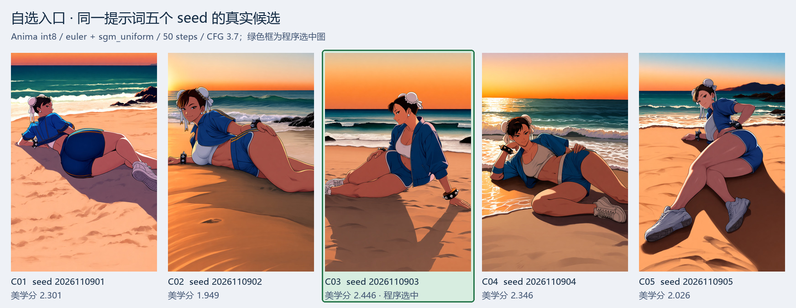

# 自选出图系统

入口实现位于 [`anima_pipeline/cli/custom_entry.py`](../anima_pipeline/cli/custom_entry.py)，仓库根目录的 `custom_entry.py` 保留为兼容启动脚本。它使用与自动本地出图相同的 DeepSeek V4 Flash 1017 → Anima-2.9B 提示词链；由你指定人物、主题和绘图参数，程序负责查资料、预检、设计、审查、采样及本地选图。

## 启动

```powershell
python custom_entry.py --list
python custom_entry.py --dry-run
python custom_entry.py
```

以上命令在仓库根目录运行。也可使用统一包入口：`python -m anima_pipeline custom --list`、`python -m anima_pipeline custom --dry-run`、`python -m anima_pipeline custom`。从其他目录启动时，传入根目录兼容脚本的绝对路径；不要直接运行 `anima_pipeline/cli/` 内的脚本。`.env`、工作流、标签数据和默认 `output/` 仍定位到项目目录。

`--list` 只列工作流、采样器、画风组合及主题，不需要密钥或 ComfyUI。`--dry-run` 会走完菜单并打印选择，不调用 DeepSeek、不检查或启动 ComfyUI、不出图；它不能证明模型、节点、网络或评分器已经配置正确。

真实生成前按根目录 [README](../README.md) 配置 API 密钥、ComfyUI 与模型，五选一还要提前准备本地评分器。

## 菜单顺序和含义

| 顺序 | 输入 | 选项与行为 |
|---|---|---|
| 1 | 工作流 | `1`：Anima `api`；`2`：Anima `anima_flow`；`9`：修改本进程 ComfyUI 路径后返回；`q`：退出。两条线用同一个绘图模型。 |
| 2 | 权重 | `1` 随机、`2` 原生 bf16、`3` int8。只有一种权重时显式选择它。 |
| 3 | 采样器组合 | 仅 `api` 提问；`0` 或留空随机，`1..4` 对应当前配置的四组组合。Flow 使用 `ANIMA_FLOW_SETTINGS`。 |
| 4 | 画风组合 | `r` 或留空随机，`0` 不加，`1..27` 指定当前画风池的一项；以 `--list` 显示的实际编号为准。 |
| 5 | 人物资料 | 人物中文名、作品中文名、人物英文标签、作品英文标签、外观版本。中文名可空，两个英文标签必填；外观版本默认 `default appearance`。 |
| 6 | 主题 | `1..18`，留空默认 `13` 四季常装。 |
| 7 | 背景来源 | `1` mixed：约 1/3 固定场景池、2/3 DeepSeek 设计；`2` deepseek；`3` fixed。 |
| 8 | 张数 | `1` 单张；`5` 或留空是同一提示词换 5 个 seed 后按美学分选一张。 |
| 9 | 起始 seed | 留空随机；输入整数后五选一依次加 1。每个 seed 都须在 `0..2147483647`，超范围会报错。 |

当前采样器组合：`euler + sgm_uniform`、`res_multistep + linear_quadratic`、`er_sde + beta57`、`uni_pc + ddim_uniform`，均为 50 步。CFG 由画风策略设置：有画风标签时 3.7，无画风时 3.5～5.0 随机。

当前 18 个主题：

| 编号 | 主题 | 编号 | 主题 | 编号 | 主题 |
|---:|---|---:|---|---:|---|
| 1 | 泳装 | 7 | 婚纱 | 13 | 四季常装 |
| 2 | 比基尼 | 8 | 护士 | 14 | 春景 |
| 3 | 和服 | 9 | 制服 | 15 | 夏景 |
| 4 | 浴衣 | 10 | 运动 | 16 | 秋景 |
| 5 | 女仆 | 11 | 旗袍 | 17 | 冬景 |
| 6 | 圣诞 | 12 | 礼服 | 18 | 背景 |

四季常装参考当前季节；春景／夏景／秋景／冬景按指定季节设计环境及常装。“背景”偏向保留官方服装并设计环境，依然有人物。室外泳装需有可识别海滩；室内泳装则按泳池规则，和服主题禁止摊位。

“fixed”只是从可配置的场景文字清单里确定本次地点，仍会协调光照、季节、服装和可见范围，不会读取背景参考图片。这里没有边缘参考图或 ControlNet 的必选输入。

## 一个输入例子

```text
工作流：1
权重：2
采样器：1
画风：r
人物中文名：甘雨
作品中文名：原神
人物英文标签：ganyu_(genshin_impact)
作品英文标签：genshin_impact
外观版本：default appearance
主题：3
背景来源：2
张数：1
起始 seed：12345
```

示例只说明输入格式，并不保证一个特定 seed 一定好看。人物／作品英文标签建议使用 Danbooru 标准写法，特殊版本要写清，避免将多个版本的发型、饰品、服装混成一张卡。

## 确认后实际发生什么

1. 创建本次独立输出目录，读取 API 密钥；开始真实联网研究。每次新任务重新研究，不读取长期人物卡。
2. 在同一 Session 中抽取人物事实并逐条核对，必要时按上限自动修正。换装事实与身份事实分离。
3. 分别设计服装、场景动作、镜头关系，写成结构化稿，再做环境／光照和最终视觉协调。动作、可见部位、服装和镜头互相约束。
4. 进行契约检查与条件式语义审查；只修问题字段及必要依赖。无法通过则保留本次数据并明确结束，保持你指定的人物。
5. 文本通过后检查 ComfyUI；按所选权重、画风、采样器、seed 生成单张或五个候选。`finally` 恢复本次临时参数覆盖，避免影响同进程下一次调用。
6. 本地评分、保留全部候选并复制最高分图到“程序选中图”，生成 `查看图片.html`。`last_entry.json` 记录本次选择。

程序不会把候选自动发到任何平台。评分器只排序观感倾向，人物脸、四肢、复杂接触和背景仍需看图确认；评分器缺失时会返回 0 分并在同分中随机选择，不能当作正常美学选优。

## 真实五选一示例

下面是一轮已完成的自选入口运行：春丽／运动主题／DeepSeek 背景设计／int8 权重／`api` 工作流／`euler + sgm_uniform`／50 步／CFG 3.7。五张使用同一份实际正负提示词、画风和采样设置，seed 从 `2026110901` 连续递增到 `2026110905`。



`kawaimasa/kawai-aesthetic-scorer-convnextv2` 给出的分数依次为 2.301、1.949、**2.446**、2.346、2.026，程序选中了第三张。分数是等级概率的加权期望，不能读作画质百分比。候选的身体朝向与姿势仍会随 seed 改变，最高分也不能证明动作执行最准确。

本例来自公开代码隔离前的真实运行：复用了已有人物资料，再实际执行语义核对、画面设计、出图和评分；公开入口会重新研究人物。完整单图和说明见[样图说明](SAMPLES.md#自选入口同一提示词五个-seed)，可复核的实际提示词、seed 和绘图参数见 [`sample_prompts.json`](sample_prompts.json) 中的 `C01..C05`。示例 JSON 是文档数据，不是可直接传入程序的完整 ComfyUI 图。

## 与自动入口的区别

自动入口 `python pipeline_character.py` 多了“模型选人物／主题、规范标签、人物范围门控”和有限换人。自选入口使用你给出的名字／标签／版本，跳过自动选角和其门控，但仍有相同的人物事实预检、来源与版本约束、设计、写作、审查及出图。

自动入口确认角色出道年不晚于 2021 时强制使用画风标签；其余人物按 50% 概率。自选菜单的明确选择优先，选“不加”就不加，指定组合就用该组合；“随机”沿用当前进程的画风策略，独立启动时通常是 50%。它不会为决定画风而额外联网查出道年。

两者都只运行本地任务。公开版不包含定时触发、发布排期、账号认证、长期人物轮换、拒绝账本或跨次缓存。`output/` 的本次证据用于查看与复现，不自动成为下一次运行资料。

## 参数化调用

```python
from anima_pipeline.cli.custom_entry import generate
from anima_pipeline import config

result = generate(
    "api", "Anima KSampler",
    {"name_cn": "甘雨", "series_cn": "原神",
     "name_en": "ganyu_(genshin_impact)", "series": "genshin_impact",
     "version": "default appearance", "theme": "和服"},
    variant="native", sampler=None, artist="random", route="deepseek",
    count=1, seeds=[12345],
)
print(result.selected)
print(result.candidates)
```

`artist` 是兼容保留的内部参数名，表示画风组合：`"random"` 随机、`None` 不加、具体模型标签字符串则指定。采样器参数可以传 `config.KSAMPLER_COMBOS` 中的一项。不要在同一 Python 进程并发调用多个 `generate`：它会临时覆盖模块参数，当前设计是顺序执行；需要并行时使用各自进程与独立输出目录。

结果主要在 `output/custom/`，自动入口在 `output/automatic/`。保留全部候选、实际提示词及提交图；改 seed 时先固定其他参数，再比较效果。每次重新运行菜单会重新生成文字，严格对照应复用已保存的实际提示词和采样设置。
