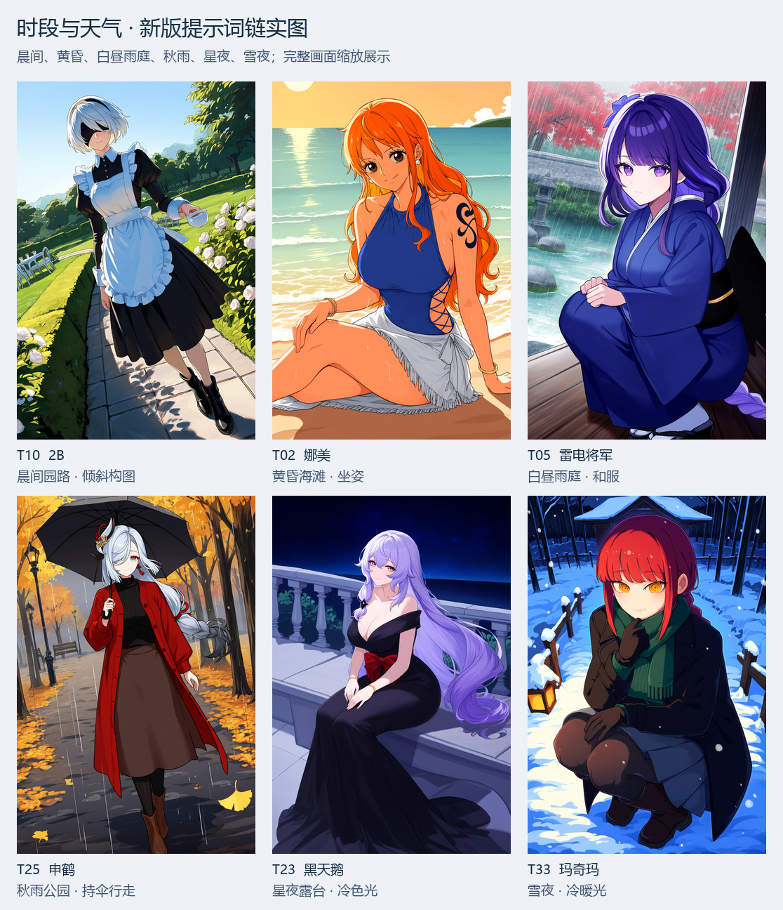
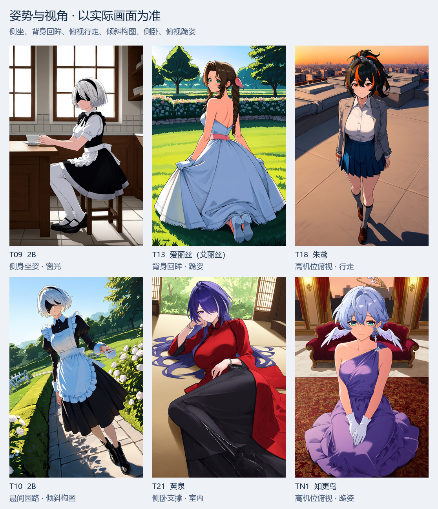
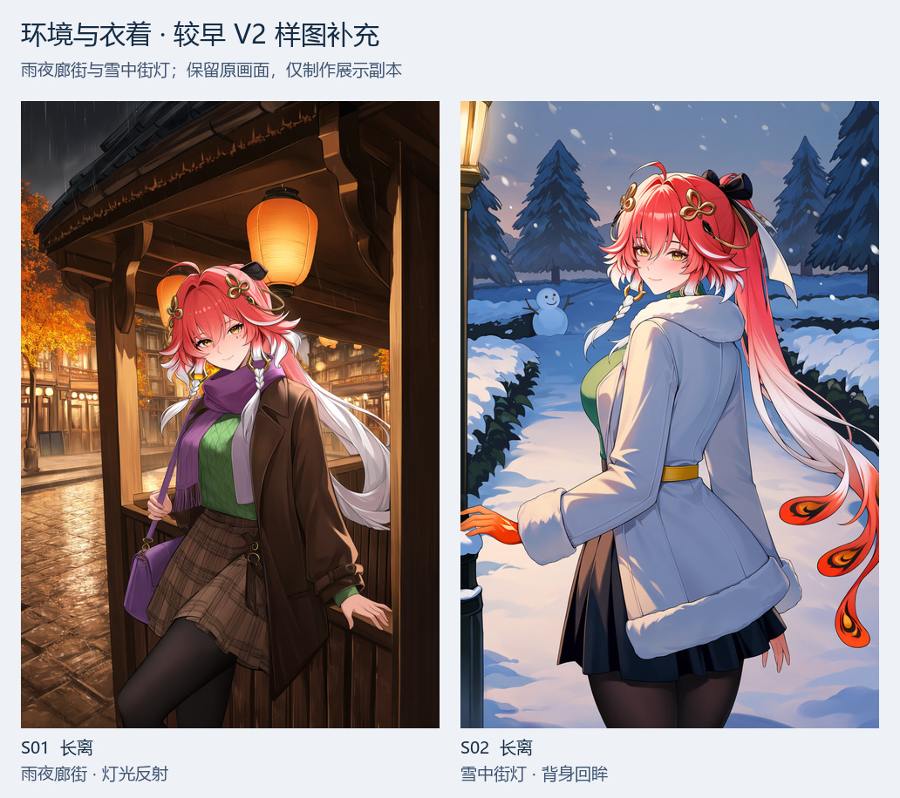
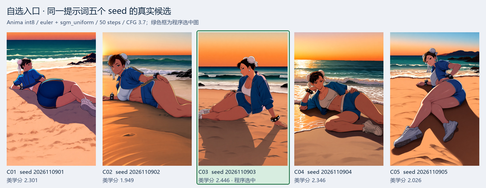
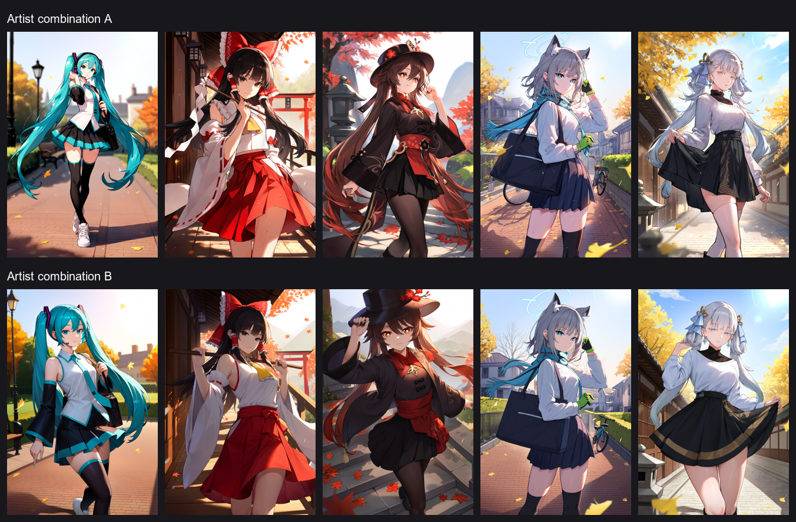

# 新版提示词链：实图与功能对应

这里整理 **19 张已有真实出图**，并保留原来的画风组合对照图。可点击表格中的单图查看原尺寸展示副本，实际正负提示词、结构化创意字段、seed、权重与采样设置见 [`sample_prompts.json`](sample_prompts.json)。

新展示副本均保留原画面和原尺寸，没有裁切、美化、重打光或修脸；为控制仓库体积，重新编码为 JPEG 并移除工作流与 EXIF。拼图只等比缩放、加标签和排版。JSON 是脱敏文档示例，不含原始人物卡、联网记录、私有路径或完整执行日志，也不是可直接提交的 ComfyUI 工作流。

## 样图来自哪些运行

| 编号 | 来源 | 能据此核对的内容 |
|---|---|---|
| `T02..T33`、`TN1`，共 12 张 | 2026-11-09 的新版 V2 集成运行，均使用 `anima_flow` | 从服装、场景动作、构图、写作、环境光照到最终文字协调后的实际画面；其中既有样例复用了已批准人物资料，`TN1` 属新增人物研究组。 |
| `S01..S02`，共 2 张 | 较早 V2 调试阶段保留的环境样图，均使用 `anima_flow` | 雨夜空间／反射、雪中街灯／背身回眸等可见效果；不冒充当前公开版重新运行结果。 |
| `C01..C05`，共 5 张 | 2026-11-09 自选入口的一次完整运行，使用 `api` | 指定权重、采样器与画风，同词换 seed、本地评分和程序选图；该次也复用了既有人物资料，再实际执行语义核对和后续生成链。 |
| 历史画风 A/B 图 | 早期公开版已有文件 | 只保留历史比较画面，不作为新版提示词结构的验收。 |

这些运行先于公开代码的隔离整理。公开版保留了同类提示词链，但移除了长期人物缓存，每次新任务重新研究；联网资料、LLM 写法及节点版本变化都会影响复现。需要单独复现图像时，应固定已保存的**实际正负提示词**和全部绘图设置，不要重新写一份文字再称作同 seed 对照。

此页是选图展示，不是成功率报告，也不是控制变量的新旧版 A/B。人物、主题、权重、画风和场景可能同时不同；只有 `C01..C05` 是同提示词、同参数仅更换 seed 的完整候选组。

## 时段与天气



| 单图 | 实际可见效果 | 阅读边界 |
|---|---|---|
| [T10：2B／女仆](samples/t10_2b_dutch_walk.jpg) | 园路、树木、日光与斑驳阴影，人物行走。 | 文字选择晨间，但图面更接近一般晴天；不能仅凭它证明明确的日出时刻。 |
| [T02：娜美／泳装](samples/t02_nami_sunset.jpg) | 橙色晚霞、低太阳、海水与沙滩，坐姿和侧面亮部。 | 是黄昏海滩示例，不是与晨间图固定其他参数的时段对照。 |
| [T05：雷电将军／和服](samples/t05_raiden_rain.jpg) | 雨线、灰色日光、庭院与廊台、闭合和服轮廓；没有摊位背景。 | 文字里的倾斜镜头只部分落实，不把它当强烈倾斜视角示范。 |
| [T25：申鹤／四季常装](samples/t25_shenhe_autumn_rain.jpg) | 持伞行走、湿路、秋叶、雨幕，针织／外套／裙装的季节层次。 | 写作选择傍晚，图面主要读作阴雨秋日；暖色点光不突出。 |
| [T23：黑天鹅／礼服](samples/t23_black_swan_night.jpg) | 深蓝星空、露台、冷色环境光与黑色礼服。 | 星夜明确，文字要求的暖灯补光没有同样明确地显现。 |
| [T33：玛奇玛／冬景](samples/t33_makima_snow_night.jpg) | 雪夜、蓝色冷环境、暖灯亮部，外套／围巾／手套和紧凑蹲姿。 | 可观察冷暖关系，不意味着所有指定灯位与阴影都逐项准确。 |

上述例子对应 `design_scene` 的时段／天气选择与 `design_environment` 的空间／光照协调。昼、昏、夜与晴、雨、雪均有画面示例；自动流程按主题和场景组织这些条件，不保证平均覆盖所有组合。

## 姿势与视角



| 单图 | 实际落实的姿势／镜头 | 不应扩大解释的部分 |
|---|---|---|
| [T09：2B／女仆](samples/t09_2b_side_seated.jpg) | 身体侧向坐在桌边，手与杯子在桌面附近，窗光来自同一室内。 | 简单接触示例，不能推导出复杂手指操作可靠。 |
| [T13：爱丽丝（Aerith）／婚纱](samples/t13_aerith_back_view.jpg) | 背向身体、转头回看、跪姿与铺开的裙摆。 | 提示词里的象牙白裙在图中偏蓝；姿势可读不等于服装颜色完全保真。 |
| [T18：朱鸢／制服](samples/t18_zhu_yuan_high_angle.jpg) | 从较高机位看向行走人物，地面透视、身体缩短关系和投影清楚。 | 使用无画风标签、CFG 4.69；不能直接与 CFG 3.7 的其他图比较优劣。 |
| [T10：2B／女仆](samples/t10_2b_dutch_walk.jpg) | 建筑／园路与人物共同构成倾斜画面，行走状态清楚。 | 倾斜构图与俯仰视角是不同维度；手部仍需独立看图。 |
| [T21：黄泉／旗袍](samples/t21_acheron_reclining.jpg) | 身体沿软垫横向展开，肘部支撑形成侧卧／倚卧关系。 | 不把它当复杂运动或器械接触的证明。 |
| [TN1：知更鸟／礼服](samples/tn1_robin_high_angle.jpg) | 高机位俯视、抬头和裙摆聚拢的跪姿，人物与室内家具保持空间关系。 | 裙装遮挡了膝部；仅能观察整体姿势，无法据此核实隐藏关节。 |

流程中 `pose` 负责身体和接触关系，`composition` 负责相机和裁切，`scene_state` 约束可见部位，再进行最终文字协调。此页展示这些职责能形成不同实际画面；绘图模型仍会简化动作，不能把几个成功示例宣传为任意姿势、任意镜头都可精确控制。

## 换装、环境与光照

不同人物的换装并不只替换一个衣服标签：例如 [T25](samples/t25_shenhe_autumn_rain.jpg) 的红黑秋装和伞、[T16 八重神子／护士](samples/t16_yae_day_interior.jpg) 的白粉服装与窗边室内、[T23](samples/t23_black_swan_night.jpg) 的黑色礼服与夜间露台，分别形成配色、层次和地点搭配。图片可以展示这些设计输出，不能单独证明其每个细节均有官方依据；身份事实与创意服装的边界要查看实际事实卡和审查记录。

以下两张从较早保存的 V2 图片中补充，主要展示环境／衣着的完整性。它们不是本页 2026-11-09 新版组，也不是同 seed 的照明 A/B。



| 单图 | 画面中可见的效果 | 实际参数 |
|---|---|---|
| [S01：长离／雨夜廊街](samples/s01_changli_rain_night.jpg) | 暖灯、深色街巷、湿石面反射和前后景；针织／外套／格裙层次。 | int8、Flow、50 步、CFG 3.7、seed `2026110302`。 |
| [S02：长离／雪中街灯](samples/s02_changli_snow_back.jpg) | 飘雪、白色毛绒外套与街灯，背向身体与回头形成姿势变化。 | int8、Flow、50 步、CFG 3.7、seed `2026110301`。 |

## 自选入口：同一提示词五个 seed

这次运行由自选入口 `custom_entry.py` 完成（当前实现位于 [`anima_pipeline/cli/custom_entry.py`](../anima_pipeline/cli/custom_entry.py)），指定春丽／运动／DeepSeek 场景来源／int8／`api`，采样为 `euler + sgm_uniform`、50 步、CFG 3.7。实际画风标签为 `@uriah-oyu, (@mokoiscat:0.65)`。五张保持正负提示词、权重、采样器、画风和尺寸一致，只更换 seed；没有为每张重跑一遍 LLM 写作。



| 候选 | seed | 实际美学分 | 程序选择 |
|---|---:|---:|---|
| [C01](samples/c01_chun_li_seed2026110901.jpg) | 2026110901 | 2.301 | |
| [C02](samples/c02_chun_li_seed2026110902.jpg) | 2026110902 | 1.949 | |
| [C03](samples/c03_chun_li_seed2026110903.jpg) | 2026110903 | **2.446** | **选中** |
| [C04](samples/c04_chun_li_seed2026110904.jpg) | 2026110904 | 2.346 | |
| [C05](samples/c05_chun_li_seed2026110905.jpg) | 2026110905 | 2.026 | |

评分模型为 [`kawaimasa/kawai-aesthetic-scorer-convnextv2`](https://huggingface.co/kawaimasa/kawai-aesthetic-scorer-convnextv2)，分数为 `5*p(SS)+4*p(S)+3*p(A)+2*p(B)+p(C)`，是等级期望分。表中分数来自该次真实运行，没有为文档重新评分。绿色框验证“按最高分选择”的行为；它不证明选中图的人物、动作、人体一定最准确。实际候选中身体朝向、侧卧／侧坐程度有明显变化，正好说明固定文字仍有 seed 随机性。

菜单使用、参数化入口及自动入口的差别见 [`CUSTOM_ENTRY.md`](CUSTOM_ENTRY.md)。

## 如何对照提示词与图片

`sample_prompts.json` 中每个 `samples[]` 记录包含：

- `id`、`character`、`theme`、`image`：页面编号、人物主题与相对单图路径。
- `source_kind`：新版 V2 集成、较早 V2 补充或自选入口真实候选。
- `model`、`workflow`、`parameters`、`original_size`：实际权重、线路、seed／采样设置和尺寸；编码器、VAE 等也按实际图记录。
- `positive`、`negative`、`pair_sha256`：从源 PNG 内嵌实际图读取的渲染文本及文本对 hash，不是从较早写作草稿重新拼的文字。
- `structured_fields`、`design_choices`：新版组的服装／动作／场景／光照／镜头等文字字段，以及阶段实际选择；用于比较“文字要求了什么”和“画面实现了什么”。
- `aesthetic_score`、`selected`：仅自选五候选组提供该轮真实分数及选中标志。

例如 `T25` 的实际字段开头如下，完整段落与最终编译顺序见 JSON：

```text
pose: walking forward along the path, one hand around the umbrella handle held above her head,
      the other hand relaxed at her side, shoulders slightly turned along the path...

scene: rainy autumn park, evening, rain, grey sky, wet path, puddles, fallen leaves,
       ginkgo and maple trees...

lighting: evening, rain, wet grey sidelighting, wet shadow:
          cool rain light from the upper left of the frame lights her left cheek...

composition: dutch angle, camera at waist height in a front three-quarter view slightly to her left...
```

这里的 `pose` 不负责相机，`composition` 不重新设计一个动作；环境和光照在同一条雨天公园路径中。对照实图可以看到雨伞、雨路和秋装，但夕照／倾斜程度并不完全按字面执行。准确记录这种差别，比只发布一张没有提示词的“成功图”更适合微调。

`pair_sha256` 的算法是对 `[positive, negative]` 使用 UTF-8、`ensure_ascii=False`、`sort_keys=True`、`separators=(',', ':')` 进行 JSON 编码后取 SHA-256。它校验文本是否相同，不是 JPEG 文件的 hash，也不表示模型一定理解全部文字。展示 JPEG 为重新编码的副本，不用于像素级生成复现。

重新生成时，在对应权重／节点已安装的同一工作流中填入记录的实际正负词、seed、尺寸和全部采样设置。`api` 与 `anima_flow` 不能互换采样参数；程序每次重新调用 LLM 会产生新稿，需要保留文字才能做严格的换 seed 对照。

## 历史画风组合对照：原文件保留



这一张沿用原始 `artist_groups_ab.png`，图内标签、排列、像素和文件字节均未更改。原图使用的提示词与早期环境不同，保留它便于回看画风比较；不能把它与上面的新版样图拼成其他变量固定的对照。页面统一称“画风组合”，保留历史文件名与原图英文标签。

## 哪些功能需要怎样的证据

| 功能 | 此页证据 | 还需核对 |
|---|---|---|
| 时段／天气进入场景与光照 | `T02/T05/T10/T23/T25/T33` 实图及实际文字 | 时刻、灯位和局部阴影的精确执行仍需逐图判断。 |
| 动作与镜头分开，再协调可见性 | `T09/T10/T13/T18/T21/TN1` 的姿势差异及字段 | 不能保证任意动作或低概率镜头，复杂器械接触未在此证明。 |
| 换装、地点与材质协同 | `T05/T16/T23/T25`，以及较早的 `S01/S02` | 图片不足以证明官方事实支持，需要查看本次人物资料／审查。 |
| 两条采样工作流 | 新版组／补充组为 `anima_flow`，自选五候选为 `api` | 没有用同一人物和固定文字比较两线画质，不给两线排名。 |
| 同词五 seed、美学排序与选图 | 完整 `C01..C05`，分数与选中图对应 | 评分是审美模型偏好，不是身份或人体正确率。 |
| 事实修正、逐字引文、版本门控、预算恢复 | 图片不能单独证明这些代码行为 | 读 [`ARCHITECTURE.md`](ARCHITECTURE.md) 与本次输出审计记录；不以漂亮样图替代执行证据。 |
